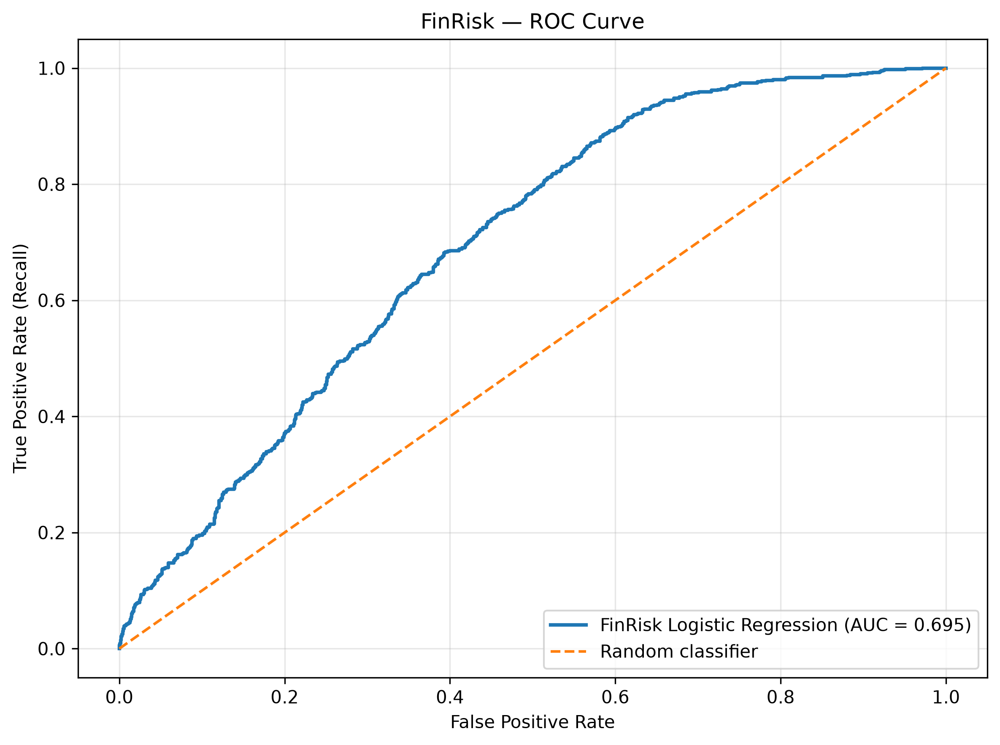

# FinRisk — BNPL Credit Risk Assessment System

An educational machine learning project that explores credit risk in Buy Now, Pay Later (BNPL) services using Python, Pandas, and Scikit-learn.

## Project Overview

FinRisk analyzes customer and transaction-related features to estimate the probability of BNPL payment default. It combines data exploration, machine learning, and an interactive Streamlit dashboard in one project.

**Purpose:** To demonstrate data analysis, machine learning model development, and risk visualization in a fintech context.

## Dashboard Preview

The FinRisk dashboard provides an interactive overview of BNPL customer data, credit-risk indicators, and model-based default probability estimates.

## Features

- **Exploratory Data Analysis:** Examine customer data, distributions, and default patterns.
- **Machine Learning:** Train a Logistic Regression model to estimate default probability.
- **Model Evaluation:** Evaluate classification performance using precision, recall, F1-score, accuracy, and ROC-AUC.

### ROC Curve

The Receiver Operating Characteristic (ROC) curve evaluates how well the FinRisk Logistic Regression model distinguishes between customers who default and customers who repay successfully.



The model achieved a test-set ROC-AUC score of approximately **0.695**, indicating moderate ability to distinguish between the two classes. A score of 0.5 represents random ranking, while 1.0 represents perfect ranking.

These results are preliminary and should not be interpreted as proof that the model is ready for real-world lending decisions. Further validation of the dataset, target-generation process, and probability calibration is required.

- **Interactive Dashboard:** Explore the dataset and submit sample customer details for a model estimate.
- **Data Visualization:** Display charts and summary statistics through Streamlit.

## Technology Stack

- Python
- Pandas
- Scikit-learn
- Matplotlib
- OpenPyXL
- Streamlit
- Joblib

## Project Structure

```text
FinRisk-Project/
├── data/
│   ├── Buy_Now_Pay_Later_BNPL_CreditRisk_Dataset.csv.xlsx
│   ├── bnpl_customers.csv
│   └── bnpl_customers_clean.csv
├── models/
│   └── finrisk_model.joblib
├── notebooks/
├── src/
├── app.py
├── train_model.py
├── requirements.txt
└── README.md
```

## Getting Started

### 1. Install dependencies

```bash
python -m pip install -r requirements.txt
```

### 2. Train the model

Run this command from the project root:

```bash
python train_model.py
```

The trained model is saved to `models/finrisk_model.joblib`.

### 3. Launch the dashboard

```bash
python -m streamlit run app.py
```

Open the local URL displayed in the terminal.

## Dataset

The project uses a BNPL credit-risk dataset available on Kaggle:

[Buy Now and Pay Later Fintech ML Dataset](https://www.kaggle.com/datasets/shree0910/buy-now-and-pay-later-fintech-ml-dataset/data)

The prediction target is `default_flag`, which represents whether a record is labelled as a default.

## Model Evaluation

The Logistic Regression model was evaluated on a held-out test set using a classification threshold of 0.40.

| Metric | Result |
|---|---:|
| Accuracy | 63.4% |
| Default-class precision | 53% |
| Default-class recall | 66% |
| Default-class F1-score | 0.59 |
| ROC-AUC | 0.695 |
| Dummy baseline accuracy | 61.0% |

### Key Findings

- **Default detection:** The model achieved approximately 66% recall for the default class, indicating that it identified around two-thirds of actual defaults in the test set.
- **Prediction accuracy:** Default-class precision was approximately 53%, meaning that around 53% of the customers predicted as defaults were actual defaults in the test set.
- **Model discrimination:** The ROC-AUC score of 0.695 indicates some ability to distinguish between customers who defaulted and those who did not.
- **Baseline comparison:** The model's accuracy exceeded the dummy baseline by approximately 2.4 percentage points. Further evaluation is needed to establish whether this improvement is meaningful.

### Limitations

These results are preliminary and do not establish that the model is suitable for real-world credit decisions. The dataset's target-generation process and probability calibration require further validation. Additional testing, including calibration analysis, threshold selection, and evaluation on independent data, would be necessary before considering any real-world application.

**Disclaimer:** FinRisk is an educational prototype for exploring machine learning in Buy Now, Pay Later (BNPL) credit risk assessment. It is not intended for actual lending or automated credit decisions.

## Limitations and Responsible Use

- This project is for **educational and portfolio purposes only**.
- Predicted probabilities are model estimates, not verified real-world default probabilities.
- The model has not been validated for actual lending decisions.
- Further work is needed on data provenance, target leakage checks, calibration, fairness, and out-of-sample validation.

## Future Improvements

- Validate the dataset's target-generation methodology.
- Investigate target leakage and feature timing.
- Improve probability calibration and model evaluation.
- Add more interactive dashboard features.
- Strengthen testing and document reproducible experiments.

---

**Project:** FinRisk — AI-Powered BNPL Credit Risk Assessment System  
**Focus:** Fintech, machine learning, and credit risk analytics